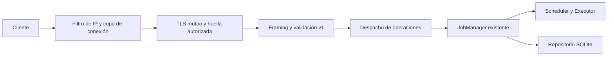

# Arquitectura de seguridad y acceso LAN/VPN

Estado: propuesta de Benjamin para Avance 3.4; pendiente de aprobación,
implementación por Backend y verificación independiente de QA.
Fecha: 16 de noviembre de 2026. Este documento no habilita puertos ni modifica
certificados, permisos, firewall, VPN o código de la aplicación.

## 1. Alcance y requisitos

Se especifican RF-20 (#90), RNF-12 (#91), RNF-13 (#92) y RNF-16 (#94), bajo
[Avance 3.4](https://github.com/DeniceMorones/Jobsy/issues/17). Las issues
consultadas no contienen criterios adicionales ni comentarios. Los valores
predeterminados y la autenticación que siguen son decisiones propuestas de
arquitectura, no condiciones numéricas impuestas por esas issues.

La implementación vigente solo ofrece IPC Unix. Conserva las validaciones de
ruta y limpieza del inode propio, pero no incluye autenticación TLS, reglas CIDR ni
autorización por usuario. No existe transporte TCP. Véanse
[interfaces actuales](interfaces-publicas.md), [ADR-003](ADR-003-Protocolo-Red.md)
y [contrato v1 propuesto](protocolo-red-v1.md).

| Requisito de Benjamin | Política especificada | Estado |
| --- | --- | --- |
| [RF-20 #90](https://github.com/DeniceMorones/Jobsy/issues/90) | Lista explícita de IP/CIDR del origen real de la conexión; denegar lo no autorizado. | Diseño; no implementado. |
| [RNF-12 #91](https://github.com/DeniceMorones/Jobsy/issues/91) | TCP desactivado por defecto; al habilitarlo, dirección de loopback predeterminada; sin comodines. | Diseño; no implementado. |
| [RNF-13 #92](https://github.com/DeniceMorones/Jobsy/issues/92) | Escucha y acceso limitados a loopback, LAN privada o VPN declarada; sin exposición directa a Internet. | Diseño; no implementado. |
| [RNF-16 #94](https://github.com/DeniceMorones/Jobsy/issues/94) | Cuenta de servicio sin root, permisos limitados y modelo de amenazas con límites explícitos. | Diseño; no implementado ni certificado. |

RNF-15 (#93) y RNF-26 (#95) son de Denice: se aportan contratos de integración,
sin modificar su código de bitácoras ni producir evidencias de demostración.
RF-16 (#72) no queda completo por escribir esta propuesta.

## 2. Confianza y autorización

Se propone un servicio para **operadores de confianza de una misma instancia**.
Un operador autorizado puede enviar, consultar, listar, cancelar y recuperar
resultados de todos los trabajos de esa instancia, además de consultar health.
No se ofrece separación de trabajos por propietario, roles de solo lectura,
sandbox ni aislamiento entre clientes. Conocer un UUID o su prefijo no autoriza.

La admisión remota exige simultáneamente:

1. IP de origen permitida por la política LAN/VPN.
2. Canal TLS con autenticación mutua válida.
3. Huella del certificado cliente incluida en la lista de operadores autorizados.

Pertenecer a una red privada o a una VPN no sustituye la identidad del cliente.
Los clientes no autorizados tampoco pueden acceder a health, status u output.
El acceso Unix conserva su protocolo local y requiere protección del directorio
y socket por permisos Linux; no se debe publicar mediante un proxy sin control.

## 3. Configuración propuesta

Estos son campos conceptuales de la futura configuración, **no opciones CLI
disponibles hoy**. Backend acordará su representación final con Benjamin.
La configuración se valida completa antes de abrir listeners y queda fija hasta
un reinicio coordinado; no se promete recarga en caliente.

| Campo propuesto | Predeterminado y regla |
| --- | --- |
| network_enabled | false; la instalación normal sigue usando únicamente el socket Unix. |
| access_profile | local; valores local, lan o vpn. Declarar vpn no prueba que exista un túnel. |
| listen_host | 127.0.0.1; IP literal unicast local al servidor, nunca 0.0.0.0, ::, un nombre DNS o una IP pública. |
| listen_port | Sin valor automático; obligatorio si se habilita TCP, entero entre 1024 y 65535. No se sustituye silenciosamente un puerto ocupado. |
| allowed_networks | 127.0.0.1/32 y ::1/128 para perfil local. En lan/vpn se exige una lista explícita no vacía que reemplaza el predeterminado. Máximo propuesto: 64 entradas. |
| tls_cert, tls_key | Certificado del servidor y clave privada, rutas explícitas; obligatorios para TCP, incluso loopback. |
| client_ca | CA dedicada que valida certificados de clientes; no usar automáticamente todas las CA del sistema. |
| allowed_client_fingerprints | Lista no vacía de huellas SHA-256 del certificado hoja DER autorizado; 64 dígitos hexadecimales por huella. Máximo propuesto: 64 entradas. |
| max_clients | 32 conexiones admitidas, incluyendo handshakes; entero >=1. Independiente de max_running. |
| max_clients_per_ip | 4, entre 1 y max_clients; se aplica a la IP normalizada, incluyendo conexiones aún no autenticadas. |
| tls_handshake_timeout | 5 s de plazo absoluto por negociación; no se renueva con cada fragmento. |

Los límites 32/4/5 s son valores iniciales para el laboratorio; necesitan revisión
y validación de carga antes de presentarlos como capacidad garantizada.
Se mantienen los plazos y tamaños de mensajes de 3.2 después del handshake.
Un error de configuración, certificado o bind aborta el arranque solicitado;
no se degrada a texto claro, a otra interfaz ni a un servicio parcialmente
configurado. La limpieza solo alcanza recursos que abrió esa instancia.

### Perfiles y direcciones

| Perfil | Espacios admisibles para escucha y reglas de origen |
| --- | --- |
| local | 127.0.0.0/8 y ::1/128; los valores predeterminados autorizan solo 127.0.0.1 y ::1. |
| lan | Loopback y rangos privados explícitos: 10.0.0.0/8, 172.16.0.0/12, 192.168.0.0/16 y fc00::/7. |
| vpn | Los anteriores; adicionalmente subredes explícitas de 100.64.0.0/10 únicamente para una VPN documentada por el operador. |

La tabla define el límite del espacio admisible, **no una lista de acceso
automática**. Solo se permite la subred o dirección declarada en allowed_networks;
una IP privada fuera de ella se rechaza. El perfil lan requiere una escucha
privada no loopback y el perfil vpn una dirección local de la interfaz del túnel.
La pertenencia de listen_host a la interfaz correcta y la ausencia de publicación
pública se verifican operativamente; una dirección numérica no demuestra ese hecho.

100.64.0.0/10 es espacio compartido, no RFC 1918 ni una prueba de VPN. No se
admite en perfil lan ni se autoriza todo ese bloque de manera implícita.
VPN con direcciones fuera de estos espacios requiere revisar el ADR antes de uso.
Las direcciones del transporte externo de una VPN no son el endpoint de Jobsy:
Jobsy solo escucha dentro del túnel privado.

### Reglas de validación

- Aceptar IP literal individual como /32 o /128, o CIDR canónico mediante
  ipaddress.ip_network(..., strict=True). Rechazar una red con bits de host;
  por ejemplo 192.168.10.42/24 no se amplía silenciosamente a toda la subred.
- Comprobar que **toda** la regla sea subred de un espacio admisible del perfil,
  no solo su primer host. Rechazar /0, redes públicas, documentación, multicast,
  link-local, direcciones indeterminadas y sintaxis con identificador de zona.
- No usar is_private o not is_global como sinónimo de autorización. Comparar
  familia, pertenencia CIDR y perfil con las redes explícitas de arriba.
- Normalizar una IP de peer IPv4-mapped IPv6 a IPv4 antes de la comparación y
  del conteo por IP. Las reglas CIDR se expresan en su familia nativa; rechazar
  reglas mapped. Un listener IPv6 debe configurar IPV6_V6ONLY para evitar
  exposición IPv4 implícita; no hay escucha dual-stack automática.
- Determinar el peer con accept/getpeername. Ignorar como identidad cualquier
  IP, usuario, cabecera de proxy o request_id aportado en el cuerpo JSON.
- Rechazar toda la configuración si hay una entrada inválida; no omitirla para
  arrancar con una política distinta. Eliminar duplicados exactos no amplía acceso.

En NAT el servidor solo conoce el origen observado. Compartir esa IP no concede
identidad y comparte también el límite por IP. Proxying, reenvíos de puertos,
UPnP y túneles públicos no forman parte del perfil admitido. En WSL se debe
revisar además la exposición del host Windows; Jobsy no configura esa red.

## 4. Identidad y protección del canal

Propuesta: TLS 1.2 como mínimo, admitiendo TLS 1.3 cuando esté disponible, con
autenticación mutua mediante ssl de Python. No se añade dependencia pip, pero
el entorno debe disponer de OpenSSL/ssl y certificados válidos.

- El servidor exige certificado cliente (CERT_REQUIRED), verifica su cadena y
  vigencia con client_ca y después compara SHA-256 del certificado hoja con
  allowed_client_fingerprints. Cadena válida sin huella autorizada no basta.
- El cliente verifica la cadena del servidor con una CA explícita y comprueba
  la identidad del endpoint. Para conexión por IP literal, el certificado debe
  incluir esa IP en subjectAltName. No desactivar check_hostname/CERT_REQUIRED.
- Usar certificados con propósito adecuado (servidor o cliente), sin claves
  privadas compartidas entre operadores. La CA privada de emisión permanece
  fuera del servidor y de los equipos usados para ejecutar trabajos.
- No incluir claves, tokens ni certificados privados en JSON, argumentos de
  comandos, repositorio o logs. La configuración contiene rutas, no el secreto.
  No habilitar volcado de claves TLS ni heredar SSLKEYLOGFILE en operación normal.
- Certificado ausente, desconocido, caducado, identidad errónea o fallo de TLS
  termina esa conexión antes de leer operaciones. No hay fallback sin TLS.

Se propone administrar altas y bajas mediante certificados individuales y
huellas explícitas. Retirar una huella y reiniciar coordinadamente aplica la
revocación en la siguiente configuración, cerrando las conexiones anteriores.
No se promete comprobación automática de revocación externa, OCSP/CRL ni
revocación instantánea mientras siga cargada la política antigua. Ante compromiso
se requiere un procedimiento del operador; el reinicio normal puede cancelar
trabajos y debe planificarse. Una renovación cambia la huella y requiere actualizarla.

Los certificados autorizan operadores con control compartido de la instancia;
no agregan propietarios a los registros de SQLite. mTLS autentica el canal, no
vuelve seguro un comando malicioso enviado por un operador autorizado.

## 5. Orden de admisión e integración

1. Validar configuración y materiales TLS antes de escuchar; recuperar el
   historial con el flujo existente antes de admitir trabajos.
2. Al aceptar, obtener IP real y comprobar perfil/lista. Si no está permitida,
   cerrar sin handshake ni respuesta JSON y sin consultar el historial.
3. Reservar un cupo de conexión global y por IP, antes de crear un worker o
   iniciar TLS. Si no hay cupo, cerrar el socket; no crear trabajo ni hilo ilimitado.
4. Completar TLS con plazo, comprobar la huella y solo entonces recibir v1.
5. Validar la solicitud y despachar al gestor. No crear procesos ni modificar
   colas, estados o SQLite desde la capa de seguridad.
6. En toda salida, cerrar el socket y liberar exactamente una vez el cupo de
   conexión. Esto no libera una reserva de trabajo ni cancela trabajos aceptados.

Los cupos de conexión y los del Scheduler tienen propietarios y sincronización
independientes. No mantener la Condition de JobManager durante TLS, recv, send,
esperas o cierre de conexiones. El límite 32 de conexiones no multiplica el
límite de tres procesos principales configurado actualmente.

Los rechazos previos a autorización no envían JSON en texto claro. Un fallo
TLS termina en la capa TLS. Después de autorizar, los errores de protocolo y
operación utilizan el contrato 3.2, sin incluir detalles internos ni secretos.

## 6. Mínimo privilegio y límites del aislamiento

- Ejecutar el servicio de red bajo una cuenta Linux dedicada sin root, sudo
  ni capacidades elevadas; utilizar un puerto no privilegiado. El perfil remoto
  debe rechazar UID efectivo 0. No crear usuarios ni modificar permisos desde Jobsy.
- Limitar permisos de la cuenta al directorio de datos y trabajo requerido.
  Código/configuración administrados por el operador, sin escritura de terceros;
  directorios de datos y socket privados (0700), archivos sensibles solo legibles
  por la identidad necesaria (por ejemplo 0600), y umask restrictiva al desplegar.
  No cambiar permisos de archivos ajenos ni borrar rutas existentes para arrancar.
- Lanzar con un entorno sin credenciales personales, agentes SSH, tokens cloud
  ni secretos del desarrollador. No montar su directorio personal completo como
  área de ejecución. Jobsy no ofrece hoy aislamiento de filesystem o red saliente.
- Mantener el IPC Unix en un directorio de confianza accesible solo a los
  operadores locales autorizados. La ruta predeterminada sigue siendo /tmp/jobsy.sock;
  su mera ubicación no prueba autorización. No alterar ni eliminar un socket activo.

**Límite crítico:** Executor ejecuta comandos con la misma identidad del daemon.
Un trabajo autorizado podría leer o alterar archivos accesibles a esa cuenta,
incluida su base, logs o clave TLS, y consumir recursos o señalar procesos del
mismo usuario. Permisos 0600 no separan procesos del mismo UID. La propuesta es
válida únicamente para operadores y comandos de confianza; no es multiusuario
hostil ni un sandbox. Separar privilegios/aislar procesos exige otra decisión.
La cuenta dedicada reduce el alcance del daño, pero no elimina este riesgo.

## 7. Observabilidad e interfaces de implementación

La auditoría remota propuesta registra hora, IP observada, identificador de
conexión, identidad de certificado autorizada, operación, request_id validado,
UUID canónico y resultado/código. Antes de validar request_id se usa un ID local
del servidor. Escapar caracteres de control y acotar campos; no registrar
cuerpos completos, argumentos de comandos, stdout/stderr ni excepciones crudas.

El código actual escribe comandos y algunos errores en bitácoras. No se afirma
que ya aplique esta política: Denice deberá adaptar la observabilidad de RNF-15
antes de habilitar red. Los resultados legítimos siguen en SQLite/output para
operadores autorizados; su almacenamiento no equivale a publicarlos en logs.

Ubicaciones propuestas, pendientes de implementar por Backend:

| Componente | Responsabilidad de integración |
| --- | --- |
| config.py | Recibir/validar configuración completa; no modificar defaults locales existentes sin acuerdo. |
| protocol/security.py (nuevo, propuesto) | Política inmutable de IP/CIDR, huellas autorizadas y construcción/validación de contextos TLS; sin dependencia de JobManager o SQLite. |
| Transporte servidor/cliente | Bind explícito, peer real, cupos, negociación TLS, plazos y limpieza; composición con codec v1 y dispatcher. |
| JobManager/Scheduler/repositorio | Reutilizar interfaces actuales; no agregar permisos ficticios por ID ni alterar reservas o recuperación. |

## 8. Transferencia y decisiones por aprobar

Benjamin entrega esta política, [ADR-009](ADR-009-Seguridad-LAN-VPN.md) y el
[modelo de amenazas](modelo-amenazas-lan-vpn.md). Deben confirmarse mTLS con
huellas, confianza compartida de operadores, perfiles IPv4/IPv6/VPN y límites
iniciales antes de implementar. Backend implementa y documenta la operación;
Alexia diseña/ejecuta la certificación independiente. Jocelyn mantiene los
entregables globales de gestión. No se actualizan aquí sus planes o matrices.

Escenarios que se transfieren, no resultados de pruebas:

- Sin configuración de red: solo Unix; al habilitar TCP, sin escucha pública.
- CIDR inválido, /0, lista vacía, IP pública, link-local y regla demasiado amplia:
  rechazo de configuración; un peer privado fuera de lista tampoco se admite.
- IPv4/IPv6, mapped, límites de subred, NAT y VPN explícita: decisión consistente
  sobre el origen real; nunca confiar en una IP declarada en JSON.
- CA/huella desconocida, certificado ausente/caducado y SAN incorrecto: ninguna
  llamada al gestor; también verificar TLS obligatorio en loopback y VPN.
- Operador válido: las seis operaciones disponibles con los mismos estados;
  todos los operadores autorizados comparten el historial por diseño.
- Root, permisos insuficientes, entorno con secretos y emisión de logs: comprobar
  las restricciones del despliegue y la adaptación de Backend, sin certificar sandbox.
- Saturación de conexiones, handshake lento, mensajes parciales y desconexiones:
  liberar cupos de red sin alterar reservas de trabajo ni terminar el daemon.
- Usar datos/certificados/sockets/puertos de prueba aislados y una LAN/VPN
  autorizada. No tocar /tmp/jobsy.sock, históricos QA ni instancias ajenas.

## Referencias técnicas

La comparación de redes usa las operaciones de [ipaddress de Python](https://docs.python.org/3.10/library/ipaddress.html),
no una inferencia de confianza basada en is_private. El espacio privado IPv4
se delimita en [RFC 1918](https://www.rfc-editor.org/rfc/rfc1918), y el espacio
compartido 100.64.0.0/10 en [RFC 6598](https://www.rfc-editor.org/rfc/rfc6598).
El prefijo IPv6 ULA fc00::/7 se define en
[RFC 4193](https://www.rfc-editor.org/rfc/rfc4193).
La API de verificación de certificados/canal se documenta en
[ssl de Python](https://docs.python.org/3.10/library/ssl.html).
Estas referencias sustentan mecanismos; las políticas y límites anteriores son
decisiones de Jobsy pendientes de aprobación, no recomendaciones atribuidas a Python.
